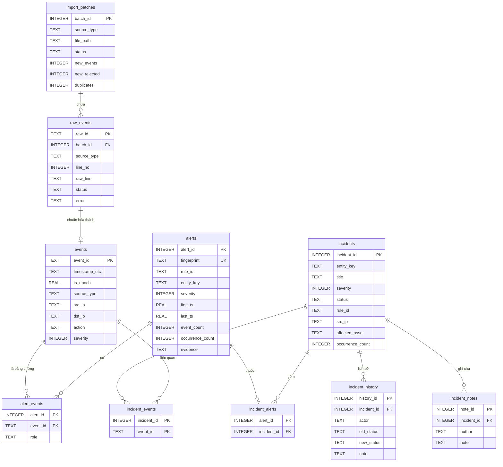

# Database ERD

## Các bảng

| Bảng | Mục đích | Khóa chính | Ghi chú |
|---|---|---|---|
| `import_batches` | Mỗi lần nhập file | `batch_id` | Phân biệt "lần nhập" với "event trùng": lần nhập lại vẫn có batch riêng, cột `duplicates` ghi số dòng đã có |
| `raw_events` | Mỗi dòng log gốc khác nhau | `raw_id` (hash) | `status` = `accepted` / `rejected`; dòng lỗi lưu `error` |
| `events` | Event đã chuẩn hóa | `event_id` = `raw_id` (FK tới `raw_events`) | Đầy đủ trường của Unified Event Schema trừ `raw_event` (dựng lại từ `raw_line`) |
| `alerts` | Kết quả của rule | `alert_id` | `fingerprint` UNIQUE; `evidence` là JSON |
| `alert_events` | Event làm bằng chứng cho alert | (`alert_id`, `event_id`) | `role` cho biết vai trò (ví dụ `failed_login`, `suricata_alert`) |
| `incidents` | Vụ việc | `incident_id` | `status` có CHECK 4 giá trị |
| `incident_alerts` | Alert thuộc incident nào | `alert_id` | Một alert thuộc tối đa một incident |
| `incident_events` | Event liên quan incident | (`incident_id`, `event_id`) | Hợp của bằng chứng các alert |
| `incident_history` | Lịch sử thay đổi trạng thái | `history_id` | Ai, lúc nào, từ đâu sang đâu, ghi chú |
| `incident_notes` | Ghi chú analyst | `note_id` | |

## Ràng buộc

- Khóa ngoại bật trên mọi kết nối (`PRAGMA foreign_keys = ON`).
- `ON DELETE CASCADE` chỉ áp dụng cho các bảng liên kết và lịch sử. Xóa incident không xóa alert hay event; event đang là bằng chứng không xóa được.
- CHECK: `severity` 1-5, port 0-65535, `status` của incident / raw event / batch.
- UNIQUE: `alerts.fingerprint`; khóa chính kép của các bảng liên kết.

## Index

| Index | Phục vụ |
|---|---|
| `idx_events_ts (ts_epoch)` | Lọc và sắp xếp theo thời gian |
| `idx_events_src_ip (src_ip, ts_epoch)`, `idx_events_dst_ip (dst_ip, ts_epoch)` | Tìm theo IP |
| `idx_events_source (source_type, ts_epoch)` | Lọc theo nguồn |
| `idx_events_severity (severity, ts_epoch)` | Lọc theo severity |
| `idx_events_action (action, src_ip, ts_epoch)` | Truy vấn của rule |
| `idx_events_hostname (hostname)` | Top target hosts |
| `idx_alerts_rule_entity (rule_id, entity_key, first_ts)` | Dedup alert |
| `idx_incidents_status`, `idx_incidents_entity`, `idx_incidents_src_ip`, `idx_incidents_created` | Tìm incident |
| `idx_alert_events_event`, `idx_incident_events_event`, `idx_incident_alerts_incident` | Lấy event/alert theo incident |

Việc dùng index được kiểm tra bằng `EXPLAIN QUERY PLAN` trong `tests/test_database.py::test_search_uses_indexes`. Tìm kiếm văn bản (`LIKE '%...%'`) không dùng được index và quét toàn bảng (0,16 giây với 500.000 event).
