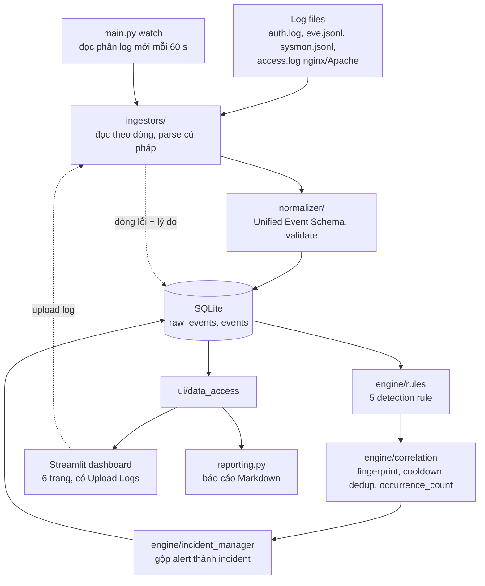

# Kiến trúc hệ thống

## 1. Sơ đồ pipeline

## 2. Trách nhiệm từng tầng

| Tầng | Vào | Ra | Không làm |
|---|---|---|---|
| Ingestion (`ingestors/`) | Một dòng text | dict các trường thô, hoặc `ParseError` có mã lý do | Không kiểm tra giá trị, không ghi DB |
| Normalization (`normalizer/`) | dict thô | `UnifiedEvent`, hoặc `NormalizationError` | Không đọc file, không ghi DB |
| Storage (`storage/`) | `UnifiedEvent`, alert, incident | Dòng trong SQLite; `models.py` định nghĩa `AlertRecord`, `IncidentRecord`, trạng thái/nhãn và `DedupSummary` | Không chứa logic detection |
| Detection (`engine/rules/`) | Bảng `events` | Danh sách `Detection` | Không ghi DB |
| Correlation (`engine/correlation.py`) | `Detection` | Alert mới / cập nhật / trùng | Không quyết định incident |
| Incident (`engine/incident_manager.py`) | Alert | Incident, lịch sử, ghi chú | Không chạy rule |
| UI (`ui/`) | Truy vấn qua `data_access` | Trang Streamlit | Không viết SQL trực tiếp |

## 3. Luồng ingest (`pipeline.ingest_file`)

1. Kiểm tra `source_type` và đường dẫn (phải nằm trong `allowed_input_dirs`).
2. Ghi một dòng `import_batches` (trạng thái `running`).
3. Đọc file theo dòng (`iter_lines`), gom thành lô `batch_size` dòng. Dòng dài hơn `max_line_length` bị từ chối và chỉ giữ 4096 byte đầu; phần còn lại không được nạp vào RAM.
4. Mỗi lô: parse -> normalize -> một transaction ghi `raw_events` và `events`. Dòng lỗi vẫn được lưu vào `raw_events` với `status = 'rejected'` và lý do.
5. Kết thúc: cập nhật `import_batches` (`completed`, số dòng mới, số dòng trùng). Nếu lỗi giữa chừng: lô đang ghi được rollback, batch đánh dấu `failed`, các lô trước vẫn nhất quán; chạy lại file sẽ bổ sung phần còn thiếu.

Idempotency: `raw_id = sha256(source_type + dòng)[:32]` là khóa chính, ghi bằng `INSERT OR IGNORE`.

## 4. Luồng detection (`pipeline.run_detection`)

Toàn bộ nằm trong **một transaction**:

1. `RuleEngine` chạy lần lượt từng rule trên bảng `events`. Rule lỗi được ghi log và báo trong `rule_errors`; các rule khác vẫn chạy.
2. `AlertManager.persist` so mỗi detection với alert đã có (cùng rule, cùng thực thể, khoảng thời gian giao nhau):
   - chưa có -> alert **new**;
   - có và có thêm event/severity -> alert **updated**;
   - có và không có gì mới -> **duplicate** (không ghi gì).
   "Đã có" gồm cả alert cùng rule, cùng thực thể cách không quá `alert_cooldown_seconds` = 600 giây mà incident chưa đóng. Cuối lượt, `AlertManager.finalize()` đặt `occurrence_count` của mỗi alert bằng số detection đã gộp vào (chạy lại nhiều lần không làm tăng số này).
3. `IncidentManager.sync_alert` gắn alert vào incident (xem `detection_rules.md` mục Correlation).

4. `Repository.dedup_summary()` tính chỉ số giảm nhiễu (raw alerts -> alert -> incident), trả trong `DetectionSummary.dedup`.

Nếu có lỗi ở bước 2-3, transaction rollback và alert/incident giữ nguyên trạng thái trước đó.

## 5. Cấu hình

`config.Settings` (dataclass bất biến). Thứ tự ưu tiên: mặc định < `config/settings.json` (hoặc file trong `SOC_CONFIG_FILE` / `--config`) < biến môi trường `SOC_DB_PATH`, `SOC_ALLOWED_INPUT_DIRS`. Khóa lạ hoặc kiểu sai trong JSON gây `ConfigError` với thông báo rõ ràng.

## 6. Database

Migration: `Database.init_schema()` thêm các cột mới vào database cũ (hiện tại: `incidents.assigned_analyst`) bằng `ALTER TABLE ADD COLUMN`, giữ nguyên dữ liệu. Nếu database còn thiếu cột, dashboard và CLI báo "database schema is out of date ... run: python main.py init-db".

SQLite, mỗi thao tác mở một kết nối ngắn và luôn đóng lại (`Database.connection()` / `Database.transaction()`). Mỗi kết nối bật:

| PRAGMA | Giá trị | Lý do |
|---|---|---|
| `foreign_keys` | ON | Ràng buộc khóa ngoại |
| `journal_mode` | WAL | Dashboard đọc được trong khi pipeline ghi |
| `synchronous` | NORMAL | An toàn với WAL, nhanh hơn FULL |
| `busy_timeout` | 5000 ms | Chờ khi có tiến trình khác đang ghi |
| `cache_size` | 64 MB | Giảm đọc đĩa khi chèn nhiều |
| `temp_store` | MEMORY | Sắp xếp tạm trong RAM |

## 7. Mở rộng

- **Thêm rule**: tạo module trong `engine/rules/` kế thừa `Rule`, cài `detect(conn)` trả về `Detection`, thêm vào `build_default_rules`. Không cần sửa correlation hay incident.
- **Thêm nguồn log**: thêm parser trong `ingestors/`, normalizer trong `normalizer/`, đăng ký vào `pipeline.SOURCES`.

## 8. Xử lý lỗi và logging

- Lỗi nghiệp vụ dùng exception riêng: `ConfigError`, `InputPathError`, `PipelineError`, `DatabaseError`, `IncidentError`. CLI in `ERROR: ...` và trả mã 2, không in traceback.
- Log dạng `key=value` qua module `logging`. Log **không** chứa nội dung dòng log gốc (có test kiểm tra).
